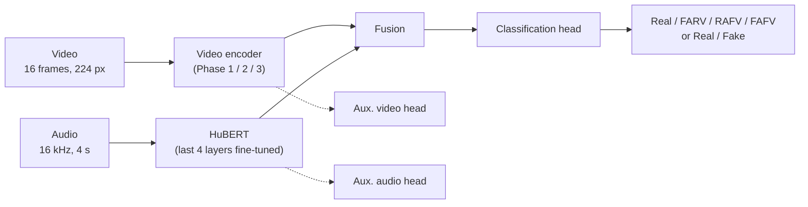
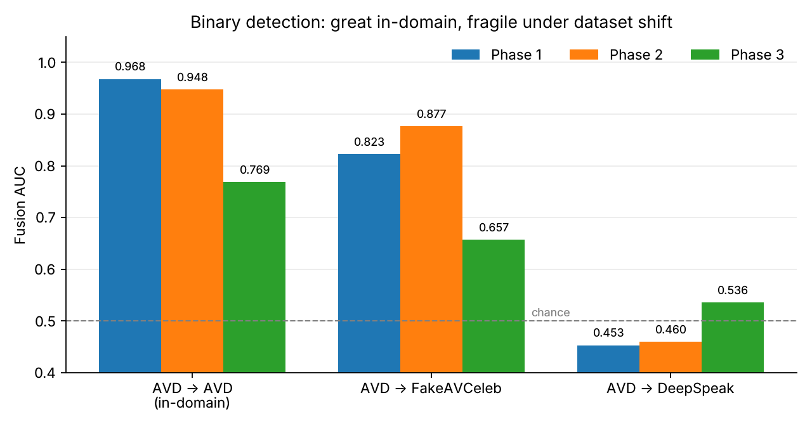
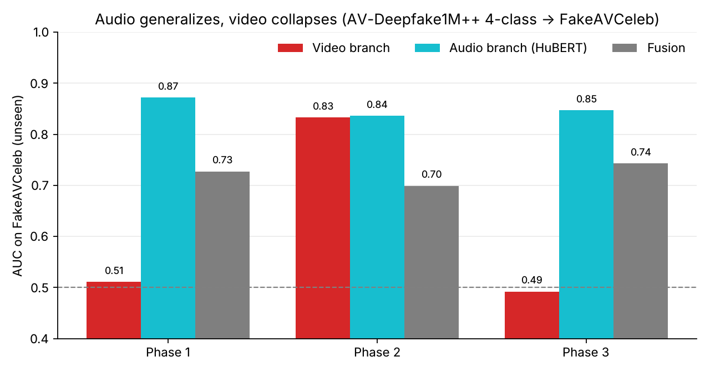
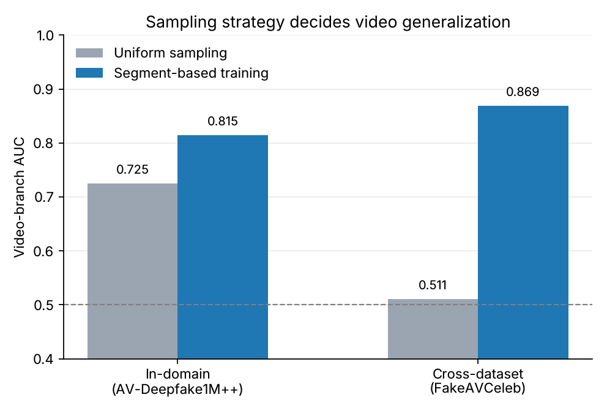

<div align="center">

# Detection of Multi-Modal Deepfakes

### Audio + video deepfake detection: a systematic comparison of ResNet-50/BiLSTM, X3D-M and TimeSformer with HuBERT

[](LICENSE)
[](https://github.com/Ali-Shariati-Najafabadi/multimodal-deepfake-detection/actions/workflows/ci.yml)


[](docs/Bachelor_Thesis_Ali_Shariati_Najafabadi.pdf)

Bachelor thesis at **TU Darmstadt** (Department of Computer Science) in cooperation with **Fraunhofer SIT**.

[Key findings](#key-findings) ·
[Architectures](#architectures) ·
[Results](#results) ·
[Quickstart](#quickstart) ·
[Citation](#citation)

</div>

---

## Why this project?

Most deepfake detectors look at the video only and answer "real or fake?". Real manipulations are messier: a voice can be cloned while the face is untouched, or the other way round, and a detector trained on one dataset often fails on the next.

This repository contains the code and results of a controlled study that asks:

1. **Which modality was manipulated?** Besides binary Real/Fake, the models solve a **four-class** task: `Real`, `FARV` (fake audio, real visual), `RAFV` (real audio, fake visual), `FAFV` (both fake).
2. **Do more complex architectures help?** Three video encoders and two fusion strategies are compared under *identical* data, preprocessing, training recipe and loss weights.
3. **Does it generalize?** Every model is evaluated on every dataset combination and separately per modality (video branch, audio branch, fusion).

## Key findings

- **Audio generalizes, video does not.** On unseen datasets the HuBERT audio branch stays informative (AUC up to 0.87) while the video branch often drops to chance level.
- **Frame sampling matters.** With uniform frame sampling the video branch overfits to dataset-specific artifacts. Segment-based training raises its cross-dataset AUC from **0.511 to 0.869** (Phase 1, four-class, AV-Deepfake1M++ → FakeAVCeleb). Note the trade-off: it needs manipulation-segment annotations, and fusion AUC in-domain drops from 0.824 to 0.764.
- **Fusion can hurt.** A poorly generalizing video branch drags the fused prediction below the better single branch. Concatenation *and* cross-attention both suffer from this.
- **More complex ≠ better.** The TimeSformer + cross-attention model (Phase 3) is behind the simpler Phases 1 and 2 both in-domain and cross-dataset, with about twice the parameters.
- **DeepSpeak v2.0 is the hardest transfer target.** All models trained on AV-Deepfake1M++ are at chance level there, even though all three phases reach AUC 0.97–0.98 on DeepSpeak in-domain.

## Architectures

All phases share the same audio branch (HuBERT), preprocessing, training procedure and loss weights. Only the video encoder and, in Phase 3, the fusion strategy change.



| Phase | Video encoder | Audio encoder | Fusion | Params (trainable) | Training time (20 ep., H100) |
|:-----:|---------------|---------------|--------|-------------------:|-----------------------------:|
| 1 | ResNet-50 + BiLSTM | HuBERT | Concatenation | 124.1 M (57.8 M) | ~16.0 h |
| 2 | X3D-M | HuBERT | Concatenation | 97.5 M (31.4 M) | ~14.6 h |
| 3 | TimeSformer | HuBERT | Cross-attention | 217.3 M (104.5 M) | ~14.5 h |

Total loss = 0.6 · fusion + 0.2 · video + 0.2 · audio. The auxiliary losses force each branch to learn meaningful features on its own and enable the per-modality evaluation.

## Results

Datasets: [AV-Deepfake1M++](https://arxiv.org/abs/2507.20579) (~50k training videos used), [FakeAVCeleb](https://arxiv.org/abs/2108.05080) and [DeepSpeak v2.0](https://arxiv.org/abs/2408.05366).

### Fusion AUC, binary task, trained on AV-Deepfake1M++

| Test set | Phase 1 | Phase 2 | Phase 3 |
|----------|:------:|:------:|:------:|
| AV-Deepfake1M++ (in-domain) | **0.968** | 0.948 | 0.769 |
| FakeAVCeleb (cross-dataset) | 0.823 | **0.877** | 0.657 |
| DeepSpeak v2.0 (cross-dataset) | 0.453 | 0.460 | 0.536 |

<p align="center"></p>

Phase 3 uses concatenation fusion in the binary AV-Deepfake1M++ setting because it beat cross-attention there (AUC 0.769 vs. 0.739, thesis Section 5.6.2).

### Audio vs. video branch (AV-Deepfake1M++ four-class → FakeAVCeleb)

<p align="center"></p>

### Uniform vs. segment-based frame sampling (Phase 1, four-class, video branch)

<p align="center"></p>

In-domain results on FakeAVCeleb are near AUC 1.0, but that dataset is small and heavily imbalanced, so the numbers are not very informative. The complete tables (all datasets, tasks and modalities) are in the thesis, Appendix A. The figures above are regenerated from those numbers by [`scripts/plot_readme_figures.py`](scripts/plot_readme_figures.py).

> **Comparability note:** published AV-Deepfake1M++ results use the TestA split and ~1.1 M training videos. This work uses a validation split and ~50k training videos, so the numbers show the pipeline works but are not a leaderboard comparison (thesis Section 5.3).

## Repository structure

```
configs/        YAML configs for every phase / dataset / task
data/           Preprocessing (face crops, frames, audio caching) and dataloaders
models/         Video encoders, HuBERT audio branch, fusion modules, phase models
training/       Training loop, losses, metrics, checkpointing
evaluation/     Cross-dataset / per-modality evaluation, ROC, t-SNE, Grad-CAM
scripts/        Plotting helpers (confusion matrices, heatmaps, training curves, ...)
logs/           Training and cross-dataset evaluation logs of the reported runs
checkpoints_new/  Best validation metrics (JSON) of the reported runs (no weights)
assets/         Figures used in this README
docs/           Bachelor thesis (PDF)
```

## Quickstart

The experiments used Python 3.10, PyTorch 2.5.1 and CUDA 12.1 on a single NVIDIA H100 (80 GB).

```bash
git clone https://github.com/Ali-Shariati-Najafabadi/multimodal-deepfake-detection.git
cd multimodal-deepfake-detection
```

```bash
conda env create -f environment.yml
conda activate deepfake-detection
```

or, without conda (Python 3.10):

```bash
pip install -r requirements.txt
```

### 1. Preprocess a dataset

Creates a sharded HDF5 cache (16 frames at 224 px, 4 s of 16 kHz audio). The datasets are **not** included, so please obtain them from their original sources and respect their usage terms.

```bash
python data/preprocessing/preprocess_deepfake.py --dataset av_deepfake --mode binary --cache-dir <CACHE_DIR>
```

`--dataset` is one of `av_deepfake`, `fakeavceleb`, `deepspeak`, `all`; `--mode` is `binary` or `4class`; `--segment-aware` enables the segment-based sampling variant.

### 2. Set the paths

The provided configs in `configs/` contain the dataset cache and output paths of the original training server (`/data/shared/...`). Adjust `cache_dir`, `tensorboard_dir` and `save_dir` to your machine.

### 3. Train

```bash
python training/train.py --config configs/phase1_avdeepfake_50k_binary.yaml
```

Config names follow `phase{1,2,3}_<dataset>_<task>.yaml`.

### 4. Evaluate (also across datasets)

```bash
python evaluation/evaluate_modality.py --config <CONFIG> --checkpoint <CKPT> --cache-dir <CACHE_DIR> --dataset <av_deepfake|fakeavceleb|deepspeak>
```

Reports AUC / UAR / accuracy separately for the video branch, the audio branch and the fusion. Trained model weights are not included.

## Reproducibility

- Fixed seed (`42`) in all configs, identical hyperparameters across phases (thesis Appendix A.2).
- Logs of the reported runs are in [`logs/`](logs/), the best validation metrics per run in [`checkpoints_new/`](checkpoints_new/).

## License

The code is released under the [MIT License](LICENSE). The datasets and pretrained models used (e.g. `facebook/hubert-base-ls960`) have their own licenses and terms of use.

## Ethical note

Deepfake detection is a dual-use topic. A detector should support, not replace, an overall forensic assessment. The datasets contain faces and voices of real people, so their license and data-protection requirements apply. False positives can harm people as much as missed forgeries. See Section 6.3 of the thesis.

## Contributing

Issues and pull requests are welcome, for example new fusion strategies (gated fusion is a motivated next step, see thesis Section 6.4), multi-dataset training, or temporal localization. See [CONTRIBUTING.md](CONTRIBUTING.md).

## Citation

If you use this work, please cite the thesis (GitHub also offers a ready-made entry via **"Cite this repository"**, based on [`CITATION.cff`](CITATION.cff)):

```bibtex
@thesis{shariati2026multimodal,
  author = {Shariati Najafabadi, Ali},
  title  = {Detection of Multi-Modal Deepfakes: A Systematic Comparison of Architectures for Audio-Visual Video-Level Classification},
  school = {Technische Universit{\"a}t Darmstadt},
  type   = {Bachelor's thesis},
  year   = {2026}
}
```

## Author

**Ali Shariati Najafabadi**, [@Ali-Shariati-Najafabadi](https://github.com/Ali-Shariati-Najafabadi)

Reviewers: Prof. Dr. Martin Steinebach, Raphael Antonius Frick.
